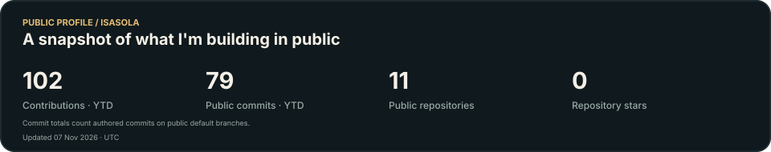
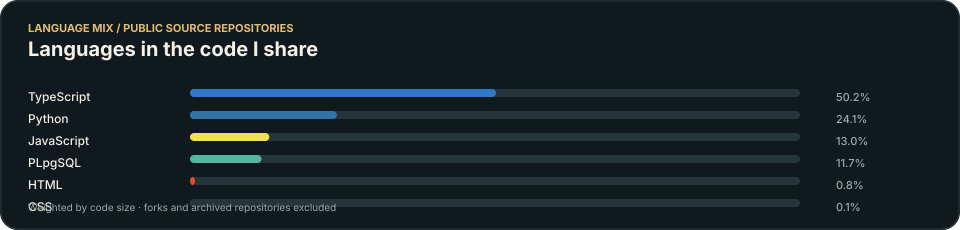
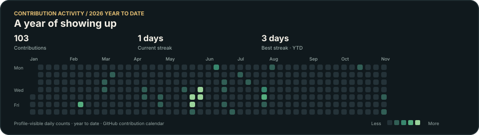

  <h1>Hey, I'm Isaías Solaeche 👋</h1>
  
<strong>Building products, exploring AI, learning by doing.</strong>

  
Entrepreneur and product builder · Paraguay

  

    <a href="https://cvitae.lat">CVitae</a> ·
    <a href="https://cvitae-studio.netlify.app/">CVitae Studio</a> ·
    <a href="https://github.com/Isasola">GitHub</a>
  

---

I like turning ideas into useful digital products, then figuring out what makes them work. I build hands-on with AI tools, test approaches in real projects, and keep learning about the technical decisions behind them.

## What I'm building

### CVitae

An AI-powered career and recruiting ecosystem for Latin America. I'm building tools that bring together professional profiles, opportunity discovery and matching, and recruiting workflows for organizations.

[Explore CVitae](https://cvitae.lat) · [Project repository](https://github.com/Isasola/cvitae-unified)

### CVitae Studio

A separate project I'm actively building toward completion: a digital studio for practical websites, online stores and catalogs, business systems, and workflow automation for businesses in Paraguay. The live site uses a warm, dark-and-cream visual direction with a project inquiry flow; I'm refining the offer and experience as it nears completion.

[Visit CVitae Studio](https://cvitae-studio.netlify.app/) · [Project repository](https://github.com/Isasola/cvitae-studio)

### Other experiments

I also explore small digital products and tools. One example is [CVitae Growth Skill](https://github.com/Isasola/cvitae-growth-skill), an open design, UX, SEO, accessibility and conversion review skill for coding agents.

## How I work

I use LLMs and AI-assisted development as part of the build process, while getting deeper into the product and engineering choices underneath: architecture, data, integrations, automation, deployment, performance and user experience.

**Building with:** React · JavaScript and TypeScript · Vite · Supabase and PostgreSQL · Netlify · GitHub Actions · AWS Bedrock and LLM APIs

**Going deeper on:** application architecture · data pipelines · API integrations · automation · SEO, AEO and GEO

The technologies above come from projects I actively work on. I add new tools here as I use them in real builds.

## GitHub activity

These cards are generated from GitHub's public profile data. The language chart measures code size across public, non-fork, non-archived repositories; commit totals count authored commits on public default branches; the activity chart follows the year-to-date contribution calendar shown on my profile.

  
  

  

## A small signature

The koi is drawn from my public GitHub activity and refreshed by GitHub Actions.

  

Still exploring. Still building. Always improving.

